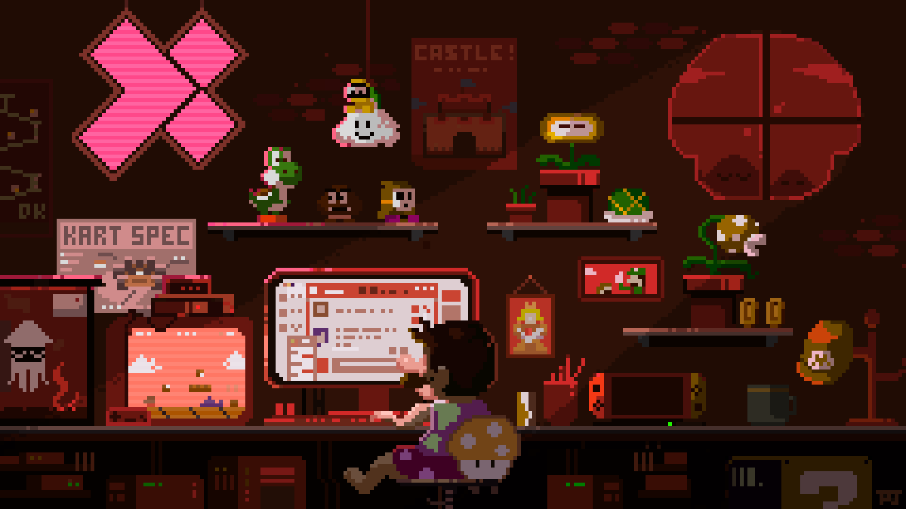
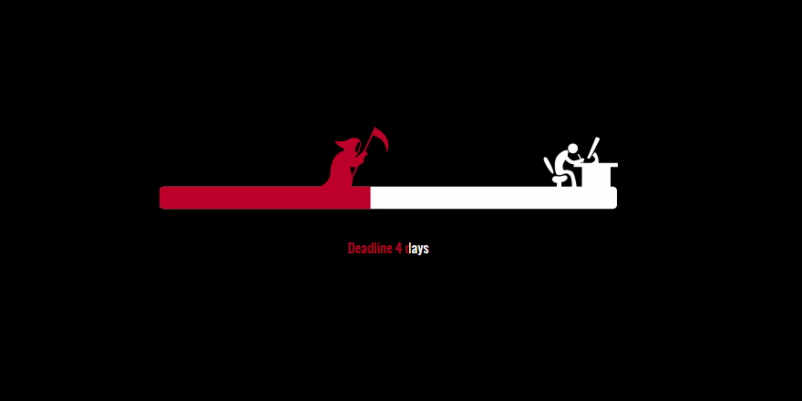
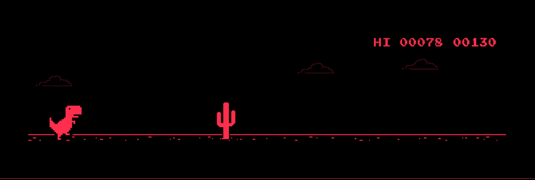

<div align="center">

<!-- ======================================================== -->
<!-- TITLE BANNER: BLEACH x LOG HORIZON x DR. STONE           -->
<!-- ======================================================== -->


<br/>

<!-- LIVE TELEMETRY WITH AIZEN + SHIROE + SENKU -->
<a href="https://git.io/typing-svg">
  
</a>

<p align="center">
  
  
  
  
  
</p>

</div>

---

# 💫 About Me (The Awakened Mastermind)

<!-- ANIMATION 1: PIXEL CODER AT DESK (FROM REFERENCE REPO) -->
<div align="center">
  
</div>

<br/>

<div align="center">

```ansi
╔══════════════════════════════════════════════════════════════════════════════════════╗
║  ✦ S Y S T E M   N O T I F I C A T I O N : A D V E N T U R E R   A W A K E N E D     ║
╠══════════════════════════════════════════════════════════════════════════════════════╣
║  • OPERATOR       : Subrat Sahu (Callsign: Shiroe / @subratsahu3)                   ║
║  • BLEACH DOMAIN  : 藍染 惣右介 (Sōsuke Aizen) — Kyōka Suigetsu Protocol             ║
║  • ALIAS          : "The Villain in Glasses" (腹ぐろ眼鏡) & Chief Science Strategist ║
║  • AFFILIATION    : Soul Society // Akiba Round Table // Kingdom of Science          ║
║  • PASSIVE SKILL  : Full Control Encounter (Predicting execution bottlenecks in adv) ║
║  • ULTIMATE MOVE  : 【 卍 解 】 ( B A N - K A I ) & 10 Billion Percent Scientific AI  ║
╚══════════════════════════════════════════════════════════════════════════════════════╝
```

</div>

---

### 🗡️ `[ BLEACH // AIZEN SŌSUKE CREED (藍染 惣右介) ]`

<div align="center">

```text
┌───────────────────────────────────────────────────────────────────────────┐
│  「やれやれ… ようこそ、私の尸魂界（ソウル・ソサエティ）へ」                │
│  "Yare yare... Yokoso, watashi no Sōru Sosaeti e."                        │
│  (Good grief... Welcome to my Soul Society.)                              │
│                                                                           │
│  「憧れは、理解から最も遠い感情だよ」                                     │
│  "Admiration is the emotion furthest from understanding."                 │
│                                                                           │
│  「一体いつから――鏡花水月を使っていないと錯覚していた？」                 │
│  "Since when were you under the impression that you were not under        │
│   my Kyōka Suigetsu?"                                                     │
│                                                                           │
│  【 卍 解 】 ( B A N - K A I )                                            │
└───────────────────────────────────────────────────────────────────────────┘
```

</div>

---

### 📜 `[ ADVENTURER LOG & QUEST OBJECTIVES ]`

- 🧪 **Primary Creation**: Built [**SpecLab**](https://github.com/subratsahu3/SpecLab-Spectrum-Analyzer) — an open-source scientific IR & Raman spectrum analysis toolkit, published globally on [PyPI](https://pypi.org/project/speclab-spectrum-analyzer/).
- 🤖 **Neural Machinery**: Architecting multi-provider conversational AI agents, autonomous decision routers, and contextual memory models.
- 🔭 **Current Focus**: Computational spectroscopy, digital signal baseline algorithms (AsLS), and LLM agent orchestration.
- 🤝 **Collaborations**: Open to deep scientific computing, autonomous agent development, and high-performance Python architectures.
- 💬 **Inquiries**: Ask me about spectral peak-detection, Savitzky-Golay filters, Gemini LLM integrations, and modern full-stack workflows.

---

### 🎯 `[ DAILY QUESTS & ACTIVE DIRECTIVES ]`

| QUEST ID | DIFFICULTY | OBJECTIVE | SYSTEM REWARD |
| :---: | :---: | :--- | :---: |
| **Q-01** | **`S-RANK`** | Expand SpecLab open spectral database library search | `10_BILLION_% EXP` |
| **Q-02** | **`A-RANK`** | Deploy multi-model autonomous agent harnesses with Gemini & Groq | `GUILD REPUTATION` |
| **Q-03** | **`B-RANK`** | Optimize Asymmetric Least Squares (AsLS) baseline engine speed | `CODE EXCELLENCE` |
| **Q-04** | **`S-RANK`** | Soul Society Mastery — Complete Hypnosis with Bug-Free Runtime | `卍解 BANKAI UNLOCKED` |

<br/>

<!-- ANIMATION 2: GRIM REAPER CHASING CODER ALONG PROGRESS BAR (FROM REFERENCE REPO) -->
<div align="center">
  
</div>

---

# 💻 Tech Stack & Science Craft Tree

<div align="center">

> *"There's nothing you can't create if you follow the scientific method. Step by step, we craft the technology of tomorrow." — Senku Ishigami*

<br/>

### `[ ELEMENTAL PROGRAMMING LANGUAGES // SCRIBE RUNES ]`
<p align="center">
  
  
  
  
  
</p>

### `[ AI & COGNITIVE SUBSYSTEMS // ENCHANTMENT RUNTIMES ]`
<p align="center">
  
  
  
  
  
</p>

### `[ SCIENTIFIC COMPUTATION & INTERFACES // SENKU WORKSHOP ]`
<p align="center">
  
  
  
  
  
</p>

### `[ CLOUD CITADEL & DEVOPS // AKIBA INFRASTRUCTURE ]`
<p align="center">
  
  
  
  
  
  
</p>

</div>

---

# 📊 GitHub Stats & Telemetry

<div align="center">

<!-- GITHUB STATS & STREAK CARDS -->


<br/><br/>

<!-- TOP LANGUAGES STATS -->


</div>

---

## 🏆 GitHub Trophies (Raid Achievements)

<div align="center">


</div>

---

## ⚔️ S-Rank Guild Raids & Artifacts (Codebases)

<div align="center">

| RAID DESIGNATION | REALM & UNIVERSE | ARTIFACT / REPOSITORY | SPELL SPECIFICATION & POWER | DEPLOYMENT STATUS |
| :---: | :--- | :--- | :--- | :---: |
| 🧪 | **Dr. STONE** | [**SpecLab-Spectrum-Analyzer**](https://github.com/subratsahu3/SpecLab-Spectrum-Analyzer) | Scientific IR & Raman spectroscopy engine + Streamlit web GUI | [](https://pypi.org/project/speclab-spectrum-analyzer/) |
| 🤖 | **Dr. STONE / Cyber** | [**Senku-AI-Assistant**](https://github.com/subratsahu3/FriendlyAIBot) | Autonomous conversational AI agent with Gemini, Groq & memory | `[CHROMED_ACTIVE]` |
| 🌐 | **Log Horizon** | [**subratsahu3.github.io**](https://github.com/subratsahu3/subratsahu3.github.io) | `NEURAL DECK v3.0` live interactive 3D web portfolio & API sync | `[PORTAL_ONLINE]` |
| 🗡️ | **Bleach // Aizen** | [**Kyoka-Suigetsu-Engine**](https://github.com/subratsahu3) | Complete Event-Driven Protocol & Autonomous Agent Orchestrator | `【 卍 解 】` |

<br/>

<a href="https://github.com/subratsahu3?tab=repositories"><b>⚡ → VIEW ALL REPOSITORIES IN THE DATABASE</b></a>

</div>

---

## 👤 Player Profile & Scico Philosophy

<div align="center">

```text
┌─── [OPERATOR LIFE PHILOSOPHY] ────────────────────────────────────────┐
│  🔭 Exploring the Universe & Tech.                                     │
│  😈 Scico. 🎵 Audiophile.                                              │
│  🚫 3D Girls = Syntax Error.                                           │
│  ⛩️ 2D Waifus = Compiled Successfully.                                 │
│  🚶‍♂️ Solitude is peace. 🌑                                               │
└────────────────────────────────────────────────────────────────────────┘
```

</div>

---

### ✍️ Strategist & Alchemist Quotes

<div align="center">

<!-- ANIMATION 3: LO-FI CODER UNDER NIGHT SKY (FROM REFERENCE REPO) -->


<br/><br/>

> *"Database, database! If this world has rules, we will learn them. If it doesn't, we will write the contracts ourselves."*  
> — **Shiroe // The Villain in Glasses (腹ぐろ眼鏡)**

> *"Step by step, humanity climbed out of the stone age. Science doesn't lie. This is ten billion percent exhilarating!"*  
> — **Senku Ishigami // Kingdom of Science (唆るぜ、これは！)**

> *"No one stands on top of the world from the beginning... but that unbearable vacancy of the throne shall end. From now on, I will stand at the top."*  
> — **Sōsuke Aizen // Bleach (藍染 惣右介)**

<p align="center">
  <b>*Pushes glasses up with palm* 👓⚡ // 【 卍 解 】</b>
</p>

<br/>

<!-- ANIMATION 4: RUNNING PIXEL DINOSAUR (FROM REFERENCE REPO) -->


</div>

---

## 🌐 Comms & Guild Channels

<div align="center">

<a href="https://subratsahu3.github.io"></a>
<a href="https://github.com/subratsahu3"></a>
<a href="https://pypi.org/project/speclab-spectrum-analyzer/"></a>
<a href="mailto:subratsahu195@gmail.com"></a>
<a href="https://linkedin.com/in/subratsahu3"></a>

<br/><br/>

<h1>Rebuilding Civilization from 0 to 1. 🧪🚀</h1>

<br/>


<br/>

<h1><i>"ようこそ、私の尸魂界へ。The Database is Watching."</i></h1>

</div>
