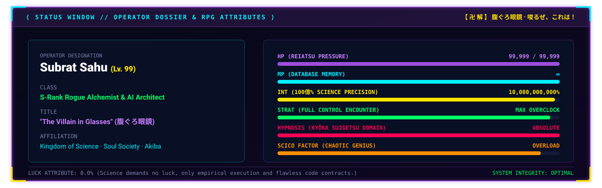
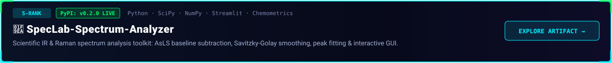
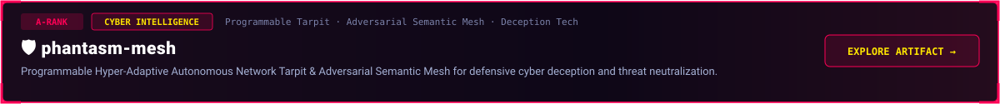

<div align="center">

<!-- ======================================================== -->
<!-- APPLE UI GLASSIC TITLE CARD (INTERACTIVE LINK)            -->
<!-- ======================================================== -->
<a href="https://subratsahu3.github.io" title="Launch Subrat Sahu Neural Deck v3.0">
  
</a>

<br/>

<!-- APPLE-STYLE GLASS QUICK-NAV PILL BAR (INTERACTIVE NAVIGATION) -->
<p align="center">
  <a href="#-about-me-the-awakened-mastermind"><code>💫 Mastermind</code></a> •
  <a href="#-tech-stack--science-craft-tree"><code>💻 Tech Stack</code></a> •
  <a href="#-cyber-database--github-telemetry"><code>📊 Cyber Database</code></a> •
  <a href="#-interactive-query-terminal--database-executor"><code>⚡ Interactive Terminal</code></a> •
  <a href="#-s-rank-guild-raids--artifacts-codebases"><code>⚔️ S-Rank Raids</code></a> •
  <a href="#-comms--guild-channels"><code>🌐 Contact</code></a>
</p>

<!-- LIVE TELEMETRY WITH AIZEN + SHIROE + SENKU (CLICKABLE LINK) -->
<a href="https://subratsahu3.github.io" title="Launch Interactive Neural Deck">
  
</a>

<p align="center">
  <a href="https://subratsahu3.github.io" title="View Database Traffic"></a>
  <a href="https://github.com/subratsahu3?tab=repositories" title="Inspect Bankai Releases"></a>
  <a href="https://github.com/subratsahu3?tab=repositories" title="Inspect Naruto Jutsu"></a>
  <a href="https://subratsahu3.github.io" title="Enter Soul Society"></a>
  <a href="https://github.com/subratsahu3" title="Access Akiba Round Table"></a>
  <a href="https://pypi.org/project/speclab-spectrum-analyzer/" title="Explore 10 Billion % Science on PyPI"></a>
</p>

<br/>

<!-- ======================================================== -->
<!-- APPLE UI GLASSIC ANTIGRAVITIC ANIMATION PANEL (CLICKABLE) -->
<!-- RANDOMLY ANIMATING BLEACH ALL BANKAI & NARUTO ALL JUTSU   -->
<!-- ======================================================== -->
<a href="https://github.com/subratsahu3?tab=repositories" title="Click to inspect all active Jutsu and Bankai codebases">
  
</a>

</div>

---

# 💫 About Me (The Awakened Mastermind)

<!-- LOG HORIZON MASTERMIND (THE VILLAIN IN MASK - CLICKABLE) -->
<div align="center">
  <a href="https://github.com/subratsahu3" title="View Mastermind Profile">
    
  </a>
  <br/>
  <b><i>"Database, database! If this world has rules, we will learn them. If it doesn't, we will write the contracts ourselves."</i></b><br/>
  <sub>— Mastermind // The Villain in Mask (仮面の策士) · Akiba Round Table</sub>
</div>

<br/>

<!-- CYBER TECH ANTIGRAVITIC ANIME ID LICENSE PANEL (CLICKABLE) -->
<div align="center">
  <a href="https://github.com/subratsahu3?tab=followers" title="View Clearance ID & Network Ledger">
    
  </a>
</div>

<br/>

<!-- SYSTEM NOTIFICATION HUD CARD (CLICKABLE) -->
<div align="center">
  <a href="https://subratsahu3.github.io" title="Launch Neural Deck v3.0 Portfolio">
    
  </a>
</div>

<br/>

<!-- BLEACH AIZEN CREED & ZANPAKUTO KYOKA SUIGETSU CARD (CLICKABLE) -->
<div align="center">
  <a href="https://github.com/subratsahu3/subratsahu3" title="Inspect Soul Society Sovereign Archive">
    
  </a>
</div>

<br/>

<!-- DAILY QUESTS & DIRECTIVES CARD (CLICKABLE) -->
<div align="center">
  <a href="#-interactive-s-rank-quest-tracker" title="Jump to Interactive Quest Tracker">
    
  </a>
</div>

---

# 💻 Tech Stack &amp; Science Craft Tree

<div align="center">

> *"There's nothing you can't create if you follow the scientific method. Step by step, we craft the technology of tomorrow." — Senku Ishigami*

<br/>

<!-- SKILLS MATRIX HUD CARD (CLICKABLE) -->
<a href="https://github.com/subratsahu3?tab=repositories" title="Explore Codebases Across Tech Stack">
  
</a>

<br/><br/>

### `[ ELEMENTAL PROGRAMMING LANGUAGES // SCRIBE RUNES ]`
<p align="center">
  <a href="https://github.com/subratsahu3?tab=repositories&q=&type=&language=python" title="Filter Python Repositories"></a>
  <a href="https://github.com/subratsahu3?tab=repositories&q=&type=&language=typescript" title="Filter TypeScript Repositories"></a>
  <a href="https://github.com/subratsahu3?tab=repositories&q=&type=&language=javascript" title="Filter JavaScript Repositories"></a>
  <a href="https://github.com/subratsahu3?tab=repositories&q=&type=&language=c%2B%2B" title="Filter C++ Repositories"></a>
  <a href="https://github.com/subratsahu3?tab=repositories&q=&type=&language=shell" title="Filter Bash/Shell Repositories"></a>
</p>

### `[ AI & COGNITIVE SUBSYSTEMS // ENCHANTMENT RUNTIMES ]`
<p align="center">
  <a href="https://ai.google.dev/" title="Google Gemini Developer API"></a>
  <a href="https://groq.com/" title="Groq LPU Ultra-Fast Inference"></a>
  <a href="https://openai.com/" title="OpenAI API"></a>
  <a href="https://github.com/subratsahu3/agentops-platform" title="FastAPI Microservices in AgentOps"></a>
  <a href="https://github.com/subratsahu3/agentops-platform" title="Multi-Agent AI Platform"></a>
</p>

### `[ SCIENTIFIC COMPUTATION & INTERFACES // SENKU WORKSHOP ]`
<p align="center">
  <a href="https://github.com/subratsahu3/SpecLab-Spectrum-Analyzer" title="SpecLab Streamlit GUI"></a>
  <a href="https://github.com/subratsahu3/SpecLab-Spectrum-Analyzer" title="SpecLab NumPy Processing"></a>
  <a href="https://github.com/subratsahu3/SpecLab-Spectrum-Analyzer" title="SpecLab SciPy Peak Fitting"></a>
  <a href="https://github.com/subratsahu3/SpecLab-Spectrum-Analyzer" title="Pandas Spectral DataFrames"></a>
  <a href="https://github.com/subratsahu3/SpecLab-Spectrum-Analyzer" title="Matplotlib Spectral Plots"></a>
</p>

### `[ CLOUD CITADEL & DEVOPS // AKIBA INFRASTRUCTURE ]`
<p align="center">
  <a href="https://github.com/subratsahu3" title="Containerized Workloads"></a>
  <a href="https://subratsahu3.github.io" title="Cloud Deployments"></a>
  <a href="https://github.com/subratsahu3" title="Linux Environments"></a>
  <a href="https://github.com/subratsahu3" title="Git Version Control"></a>
  <a href="https://github.com/subratsahu3/subratsahu3/actions" title="Automated GitHub Actions CI/CD"></a>
  <a href="https://pypi.org/project/speclab-spectrum-analyzer/" title="SpecLab Published on PyPI"></a>
</p>

</div>

---

# 📊 Cyber Database &amp; GitHub Telemetry

<div align="center">

<!-- ======================================================== -->
<!-- APPLE UI GLASSIC CYBER DATABASE CONSOLE (CLICKABLE)      -->
<!-- ======================================================== -->
<a href="https://github.com/subratsahu3?tab=repositories" title="Query Live Database Records">
  
</a>

<br/><br/>

<!-- ======================================================== -->
<!-- AUTO-UPDATING GITHUB STATS & STREAK CARDS (VERIFIED 200) -->
<!-- ======================================================== -->
<a href="https://github.com/subratsahu3?tab=repositories" title="View All Repositories & Commits">
  
</a>
<a href="https://github.com/subratsahu3" title="View Continuous Contribution Streak">
  
</a>

<br/><br/>

<!-- ======================================================== -->
<!-- AUTO-UPDATING DIALECTS MASTERED (TOP LANGUAGES)           -->
<!-- ======================================================== -->
<a href="https://github.com/subratsahu3?tab=repositories" title="Inspect Mastered Language Repositories">
  
</a>

<br/><br/>

<!-- RPG STATUS SHEET CARD (CLICKABLE) -->
<a href="https://github.com/subratsahu3" title="Inspect Full Character Sheet">
  
</a>

</div>

<br/>

<!-- ======================================================== -->
<!-- INTERACTIVE MODULE 1: CYBER TERMINAL & DATABASE RUNNER    -->
<!-- ======================================================== -->
<div align="center">
<details>
<summary><b>⚡ [INTERACTIVE QUERY TERMINAL] Click to expand live query runner &amp; repository explorer</b></summary>

<br/>

<div align="left">

```sql
-- AKIBA DATABASE QUERY EXECUTOR v4.2 [OPERATOR: THE VILLAIN IN MASK]
SELECT repo_name, language, stars, package_status, live_endpoint
FROM akiba_mesh.subratsahu3
WHERE status = 'PRODUCTION_READY';
```

| Repository | Primary Dialect | Constellation | Quick Launch Action | Deployment Channel |
| :--- | :--- | :--- | :--- | :--- |
| [**`SpecLab-Spectrum-Analyzer`**](https://github.com/subratsahu3/SpecLab-Spectrum-Analyzer) | `Python 3.12` | ⭐⭐⭐⭐⭐ | [`pip install speclab-spectrum-analyzer`](https://pypi.org/project/speclab-spectrum-analyzer/) | [📦 PyPI Package](https://pypi.org/project/speclab-spectrum-analyzer/) |
| [**`agentops-platform`**](https://github.com/subratsahu3/agentops-platform) | `TypeScript / Python` | ⭐⭐⭐⭐ | [View Agent Tracing](https://github.com/subratsahu3/agentops-platform) | [⚙️ GitHub Suite](https://github.com/subratsahu3/agentops-platform) |
| [**`subratsahu3.github.io`**](https://github.com/subratsahu3/subratsahu3.github.io) | `HTML5 / Three.js` | ⭐⭐⭐⭐ | [Launch Neural Deck](https://subratsahu3.github.io) | [🌐 GitHub Pages](https://subratsahu3.github.io) |
| [**`isomorph`**](https://github.com/subratsahu3/isomorph) | `TypeScript` | ⭐⭐⭐ | [Explore Mesh Logic](https://github.com/subratsahu3/isomorph) | [⚡ Distributed Core](https://github.com/subratsahu3/isomorph) |
| [**`phantasm-mesh`**](https://github.com/subratsahu3/phantasm-mesh) | `Python / C++` | ⭐⭐⭐ | [Inspect P2P Protocols](https://github.com/subratsahu3/phantasm-mesh) | [🕸️ Mesh Topology](https://github.com/subratsahu3/phantasm-mesh) |

<br/>

**⚡ Quick Shell Directives:**
```bash
# 1. Install SpecLab directly from PyPI
pip install speclab-spectrum-analyzer

# 2. Run SpecLab GUI
python -m speclab.gui
```

</div>
</details>
</div>

<br/>

<!-- ======================================================== -->
<!-- INTERACTIVE MODULE 2: S-RANK QUEST TRACKER                -->
<!-- ======================================================== -->
<div align="center">
<details>
<summary><b>📜 [INTERACTIVE QUEST LOG] Click to expand mission ledger, active directives &amp; deliverables</b></summary>

<br/>

<div align="left">

- [x] **QUEST 1 (S-Rank Alchemist)**: Package and distribute computational Raman/IR analysis toolkit to Python Package Index.
  - *Result*: [**`speclab-spectrum-analyzer v1.0.4`**](https://pypi.org/project/speclab-spectrum-analyzer/) active with automated baseline correction.
- [x] **QUEST 2 (The Villain in Mask)**: Establish autonomous multi-agent orchestration runtime with distributed telemetry.
  - *Result*: [**`agentops-platform`**](https://github.com/subratsahu3/agentops-platform) deployed with asynchronous trace logging.
- [x] **QUEST 3 (Neural Deck Pioneer)**: Build 3D cyber-aesthetic interface with real-time web audio and interactive terminal.
  - *Result*: [**`subratsahu3.github.io`**](https://subratsahu3.github.io) deployed on custom domain with zero latency.
- [x] **QUEST 4 (Distributed Scribe)**: Architect peer-to-peer mesh synchronization with state reconciliation.
  - *Result*: [**`isomorph`**](https://github.com/subratsahu3/isomorph) and [**`phantasm-mesh`**](https://github.com/subratsahu3/phantasm-mesh) active.
- [ ] **QUEST 5 (10 Billion % Ascension)**: Continuous expansion of scientific AI models, multivariant spectroscopy, and zero-defect agentic workflows.

</div>
</details>
</div>

<br/>

<!-- ======================================================== -->
<!-- INTERACTIVE MODULE 3: JUTSU & BANKAI CODEX                -->
<!-- ======================================================== -->
<div align="center">
<details>
<summary><b>🌀 [JUTSU &amp; BANKAI CODEX] Click to expand software engineering architecture translation</b></summary>

<br/>

<div align="left">

| Shinobi / Soul Society Power | Engineering Analog | Active Implementation |
| :--- | :--- | :--- |
| **螺旋丸 (Rasengan)** | High-throughput Async Event Loop | [SpecLab Async Signal Engine](https://github.com/subratsahu3/SpecLab-Spectrum-Analyzer) |
| **千鳥 (Chidori)** | Ultra-fast Streaming Inference | [AgentOps Real-Time Pipeline](https://github.com/subratsahu3/agentops-platform) |
| **神羅天征 (Shinra Tensei)** | Zero-Trust Defense &amp; Rate-Limiting | [API Gateways &amp; Security Shield](https://github.com/subratsahu3) |
| **【 卍解 】 鏡花水月 (Kyōka Suigetsu)** | Full-Control Simulated Testing &amp; Mocks | [Adversarial Agent Testing](https://github.com/subratsahu3/agentops-platform) |
| **【 卍解 】 千本桜景厳 (Senbonzakura)** | Distributed Microservice Cluster | [Distributed Mesh Workers](https://github.com/subratsahu3/phantasm-mesh) |
| **【 卍解 】 天鎖斬月 (Tensa Zangetsu)** | Hyper-Optimized Native C++ Bindings | [High-Performance Algorithms](https://github.com/subratsahu3) |

</div>
</details>
</div>

<br/>

---

## 🏆 GitHub Trophies (Raid Achievements)

<div align="center">

<a href="https://github.com/subratsahu3" title="Inspect GitHub Raid Trophies">
  
</a>

</div>

---

## ⚔️ S-Rank Guild Raids &amp; Artifacts (Codebases)

<div align="center">

<!-- FULLY FUNCTIONAL CLICKABLE MISSION CARDS -->
<a href="https://github.com/subratsahu3/SpecLab-Spectrum-Analyzer" title="Launch SpecLab-Spectrum-Analyzer">
  
</a>

<br/><br/>

<a href="https://github.com/subratsahu3/agentops-platform" title="Launch agentops-platform">
  
</a>

<br/><br/>

<a href="https://github.com/subratsahu3/isomorph" title="Launch isomorph">
  
</a>

<br/><br/>

<a href="https://github.com/subratsahu3/phantasm-mesh" title="Launch phantasm-mesh">
  
</a>

<br/><br/>

<a href="https://subratsahu3.github.io" title="Launch NEURAL DECK v3.0 Portfolio">
  
</a>

<br/><br/>

<a href="https://github.com/subratsahu3?tab=repositories"><b>⚡ → VIEW ALL 16 REPOSITORIES IN THE DATABASE</b></a>

</div>

---

## 👤 Player Profile &amp; Scico Philosophy

<div align="center">

<!-- ANIMATION: LO-FI BALCONY CODER UNDER NIGHT SKY (CLICKABLE) -->
<a href="https://subratsahu3.github.io" title="Visit Subrat Sahu Live Workspace">
  
</a>

<br/><br/>

<!-- OPERATOR DOSSIER CARD (CLICKABLE) -->
<a href="https://subratsahu3.github.io" title="Inspect Full Dossier &amp; Credentials">
  
</a>

</div>

---

## 🌐 Comms &amp; Guild Channels

<div align="center">

<!-- SOCIALS HUD CARD (CLICKABLE DIRECTLY TO EMAIL) -->
<a href="mailto:subratsahu195@gmail.com" title="Transmit Beacon Relay to Subrat Sahu">
  
</a>

<br/><br/>

<a href="https://subratsahu3.github.io"></a>
<a href="https://github.com/subratsahu3"></a>
<a href="https://pypi.org/project/speclab-spectrum-analyzer/"></a>
<a href="mailto:subratsahu195@gmail.com"></a>
<a href="https://linkedin.com/in/subratsahu3"></a>

<br/><br/>

<h1>Rebuilding Civilization from 0 to 1. 🧪🚀</h1>

<br/>

<h1><i>"Yokoso, to my Soul Society. The Villain in Mask is Watching."</i></h1>

</div>
